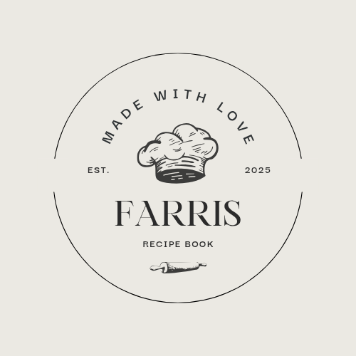

---
hide:
  - navigation
  - toc
---

  

    
  

  <h1 class="ffr-title">Farris Family Recipe Book</h1>
  
Home-cooked meals, lovingly collected and altitude-adjusted.

  

    ▲ 4,705 ft above sea level
  

  

    <a href="recipes/" class="ffr-btn ffr-btn--primary">Browse Recipes</a>
    <a href="tips/" class="ffr-btn ffr-btn--ghost">Cooking Tips</a>
  

<!-- WIP for now

  

    
🥩

    

      <strong>Mains</strong>
      
Weeknight staples and weekend showstoppers.

    

  

  

    
🥗

    

      <strong>Sides &amp; Salads</strong>
      
The supporting cast that steals the show.

    

  

  

    
🍞

    

      <strong>Breads &amp; Baking</strong>
      
High-altitude baking — the footnotes matter here.

    

  

  

    
🍮

    

      <strong>Desserts</strong>
      
Sweet endings, adjusted for the altitude.

    

  

-->

  

    Recipes sourced from family, friends, and trusted cookbooks —
    then adapted for life at <strong>4,705 ft</strong>. Look for footnotes
    throughout where altitude changes things.
  

